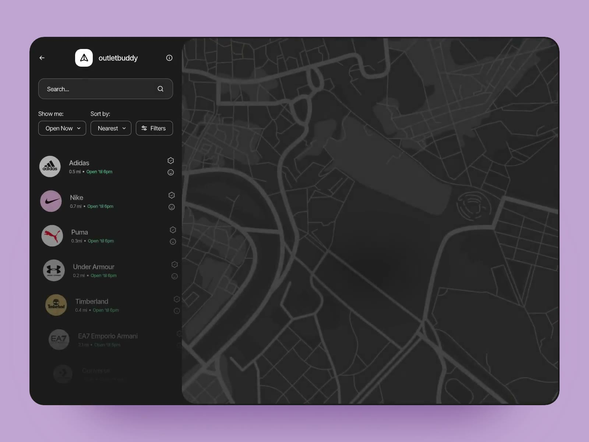
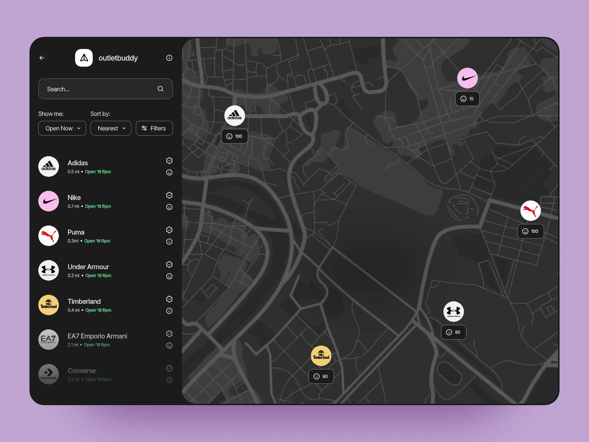
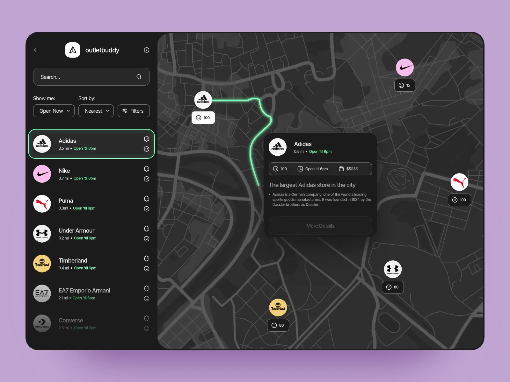
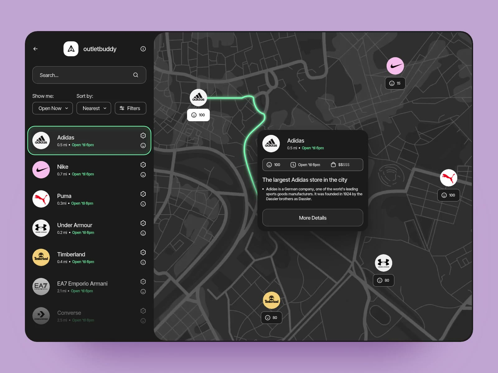
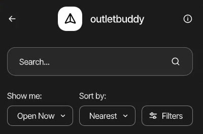
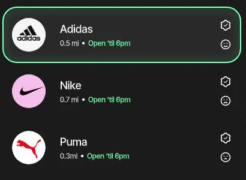
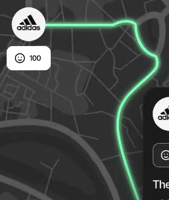

# App UI revamp — OutletBuddy-style map

Reference: Dribbble shot "OutletBuddy – Interactive Map for Nearby Store Searches"
(video saved at `~/Downloads/OutletBuddy Interactive Map.mp4`).

## Reference screens

Frames from the reference video, kept in `docs/ui-revamp/reference/` (design
by the OutletBuddy shot's author on Dribbble, used here as internal reference
only).

**The load sequence**: list → pins → route draws → card. Step 9 copies this.

| 1. List fades in | 2. Pins pop in |
|---|---|
|  |  |
| **3. Row selected, route draws** | **4. Detail card in place** |
|  |  |

**Details** (crops of frame 4):

| Search + chips (step 6) | List rows + selection (step 7) | Route card (step 8) | Pin + route glow (step 3) |
|---|---|---|---|
|  |  |  |  |

## Decisions already made

- **Scope:** the whole app, planner first. Part 1 (steps 1–10) is the planner.
  Parts 2–7 (steps 11–30) carry the same look to every other page, reusing
  pieces built in Part 1.
- **Palette:** the app keeps its current warm dark palette (`app/globals.css`).
  Nothing global is recoloured; `--primary` stays orange.
- **Accent:** orange `--primary` for route selection, route glow, and map cards, matching the rest of the app (updated at the user's request). Traffic colors remain meaningful status indicators.
- **Providers:** free only, no Google Maps (see travel-expansion decisions).

## Design language (applies to every part)

What every page converges on, so the rest of the app reads like the planner:

- **Surfaces:** page background `--background`; panels and sidebars `--card`;
  rows inside panels have no border and show a hover background only. Borders
  are reserved for panels, selected rows, and inputs.
- **Rows, not cards:** lists (routes, vehicles, trips, alerts, saved places)
  are rows. A leading 36px circle (number, icon, or emoji), a title line with
  an optional pill, a muted meta line using `•` separators, and trailing
  actions or a value.
- **Chips:** small rounded-full controls for filters, toggles, and short
  facts (`Leave now ▾`, `2 passengers`, `12.4 km`). One chip component.
- **Page header:** back link, title, one-line subtitle, optional actions on
  the right. One component instead of the copy in every page.
- **Motion:** list rows fade up 60ms apart on first load; nothing animates on
  re-render; reduced motion turns it all off.
- **Map screens** use the full-height sidebar + map shell from Part 1.

## What the reference does, and what it becomes here

| OutletBuddy | nobojatra planner |
|---|---|
| Full-height app shell: fixed sidebar left, map fills the rest | Same. Map is always visible, not only after a search |
| Logo row + search box + "Show me / Sort by / Filters" chips | Sidebar header (title, country switcher, upcoming trips) + origin/destination fields + chips (passengers, Leave now / Schedule, Stops) |
| Store list: logo, name, "0.5 mi • Open 'til 6pm", action icons | Route list: route number badge, "Route 1 · Suggested", "12.4 km • 35 min", traffic level |
| Selected row: green outline | Selected route row: orange outline + soft glow |
| Logo pins with count badges | Round A / B / numbered stop pins with a place-name chip under each |
| Glowing green route that draws itself | Active route drawn as a blurred wide orange line under a thin bright core, animated in |
| Floating detail card with "More Details" | Floating route card: distance, time, traffic, departure, **View fare estimates** |
| Dark, label-light map | CARTO dark basemap (free for non-commercial use, which fits the demo) |
| Load sequence: list → pins → selection → route → card | Same sequence after each search, skipped for reduced-motion users |

## Current state (for reference)

- `components/home/AuthedHome.tsx`: welcome bar + "Plan a route" heading + `HomeContent`.
- `components/map/MapDashboardSection.tsx` (`Planner`): before a search, a
  two-column grid of form + `SuggestionTiles`; after a search, a 380px column
  of form + results beside a 70vh bordered map. Plan Again cards render below.
- `components/map/RouteMap.tsx`: Leaflet, light OSM tiles (or Mapbox
  streets-v12), black A/B markers, per-leg rainbow colours, traffic-coloured
  segments when traffic loads, "Fit route" and "Show map traffic" buttons.
  **Also used by `FareResults.tsx` and `BestOptionsResults.tsx`.**
- `components/map/RouteResults.tsx`: route buttons + multi-stop leg list + traffic summary.
- `components/map/RouteFinderForm.tsx`: full form, ~700 lines, stays mounted
  (its state must survive; edits call `onInputChange` → `clearResults`).
- Tests read component source with regexes (`tests/route-map.test.mjs`,
  `tests/content-security-policy.test.mjs`, `tests/route-form.test.mjs`).
  Steps that change those strings must update the tests in the same step.

---

## Steps

Each step leaves the app working and can be reviewed on its own.

# Part 1: Planner (`/`)

### Step 1: Planner tokens, motion, and Leaflet dark chrome

**Status: Done.** Added the tokens, animation hooks, reduced-motion handling,
and scoped Leaflet styles. Verified with `pnpm lint` and `git diff --check`.
The map has not opted into these styles yet; that happens in a later step.

File: `app/globals.css`

1. Add map-screen tokens (planner now, fares and ranked options in Part 3)
   to `:root` / `.dark` (the app is dark-only, so both
   get the same values):
   - `--route-accent: var(--primary)` (core line, selected outline, card button)
   - `--route-accent-glow: color-mix(in oklch, var(--route-accent), transparent 65%)`
   - `--route-accent-foreground: var(--primary-foreground)` (text on an orange button)
   - expose them in `@theme inline` as `--color-route-accent*` so Tailwind
     classes like `border-route-accent` work.
2. Keyframes, all short (150–450ms), ease-out:
   - `planner-fade-up` (list rows, card): opacity 0 → 1, translateY(6px) → 0
   - `planner-pin-pop` (map pins): scale(0.6) → 1.05 → 1, opacity 0 → 1
   - `planner-route-draw` (route line): `stroke-dashoffset: 1 → 0`, used with
     `pathLength="1"` and `stroke-dasharray: 1` so no length measuring is needed
3. A `@media (prefers-reduced-motion: reduce)` block that turns all of the
   above off (final state, no animation).
4. Leaflet dark chrome, scoped to `.planner-map` so it can't leak:
   - attribution control: dark translucent background, muted text and links
   - zoom control: dark buttons, border from `--border`, no white boxes
   - tooltips: card background, foreground text, no white arrow

Done when: nothing visible changes yet; `pnpm lint` passes.

### Step 2: Dark basemap

**Status: Implemented; partial browser verification passed.** On 2026-11-08,
the configured CARTO key resolved the earlier API-key watermark. An authenticated
Bangladesh route displayed dark tiles and OpenStreetMap / CARTO credits on the
planner, fare estimates, and ranked-options screens. Without a configured key,
the code falls back to OpenStreetMap tiles. `pnpm test` (158 tests), `pnpm lint`,
and `git diff --check` passed. The ranked-options console showed no tile errors,
but DevTools reported one blocked `script-src` string-evaluation issue without
a source location; its origin is undetermined. A separate no-key development
server returned HTTP 200 but the browser view stayed blank, so fallback remains
unverified. Traffic overlay remains unverified (Bangladesh has no live traffic);
the Mapbox branch remains unverified because no Mapbox token is configured.

Files: `components/map/RouteMap.tsx`, `lib/content-security-policy.ts`,
`tests/route-map.test.mjs`, `tests/content-security-policy.test.mjs`

1. Base tiles with a CARTO key and without a Mapbox token:
   `https://{s}.basemaps.cartocdn.com/dark_all/{z}/{x}/{y}{r}.png`
   with `?key=...` (`subdomains="abcd"`, `detectRetina`), credited
   `© OpenStreetMap contributors © CARTO`.
   - `dark_all` keeps street labels, which a route planner needs. (The video
   has no labels; `dark_nolabels` is possible later but not recommended.)
   Without a CARTO key, use standard OpenStreetMap tiles as a fallback.
2. With a Mapbox token: switch the style from `streets-v12` to `dark-v11`.
3. CSP `img-src`: add `https://*.basemaps.cartocdn.com`. The OSM entries can
   be removed if nothing else loads OSM tiles. Check first.
4. Update the regex tests for the new tile URL and credit, keeping the rule
   that only on-screen providers are credited.
5. Warm tint so the grey-black tiles sit with the brown palette: a CSS filter
   on the base tile pane only (`.planner-map .leaflet-tile-pane`, e.g.
   `sepia(0.15) saturate(0.9)`), tuned by eye. It must not touch the traffic
   overlay layer (its colours carry meaning), so give the base `TileLayer` a
   `className` and filter that instead of the whole pane.

Applies to every map (planner, fares, ranked options). Intentional: the app
is dark-only, and the light tiles were the odd one out.

Done when: all three map screens show dark tiles, the credit reads correctly,
the browser console shows no CSP violations, and `pnpm test` passes.

### Step 3: Map visuals (pins, glowing route, controls)

**Status: Implemented; browser verification partial.** The planner displayed
the green route, labeled pins, dashed alternatives, dark zoom controls, and
Fit route control on a Bangladesh trip. The traffic control was absent there,
as expected. `pnpm test` (158 tests), `pnpm lint`, `tsc --noEmit`, and
`git diff --check` passed. Alternative selection, reduced motion, multi-stop,
fare and ranked-options rendering, and the traffic toggle in a supported country
still need interactive verification.

File: `components/map/RouteMap.tsx` (+ small CSS from step 1)

Reference: 

1. **Pins:** keep `numberedIcon` (and its `escapeHtml` calls, which the tests
   check), restyled: 32px circle, card background, 2px light ring, bold
   label; the place name appears as a small dark chip under the pin (same HTML
   string, escaped). The active trip's pins get `planner-pin-pop` with
   staggered `animation-delay` (A, stops, then B).
2. **Active route:** three stacked polylines, all `lineJoin/lineCap: round`:
   - glow: weight 14, `--route-accent`, opacity 0.25, CSS `filter: blur(4px)`
   - body: weight 6, `--route-accent`, opacity 0.9
   - core: weight 2, near-white warm cream, opacity 0.9
   Each gets `className="planner-route"`, plus `pathLength="1"` set once on
   the SVG element so `planner-route-draw` animates it in. Multi-stop routes
   use one orange line; the per-leg rainbow is dropped from the map (legs stay
   listed in the sidebar).
3. **Alternatives:** grey (`INACTIVE_ROUTE_COLOR`), weight 4, opacity 0.45,
   dashed, still clickable to select.
4. **Orange by default; traffic as layers where it exists.** Today, congestion
   colours replace the route colour whenever traffic loads. New: the route is
   always orange first. Where traffic exists (`canRequestTraffic(country,
   features)` is true, meaning the country has TomTom/Mapbox coverage and the
   server has a key), a "Traffic" chip on the map turns on the traffic layers:
   the congestion-coloured route segments, the TomTom/Mapbox tile overlay, and
   the existing legend (the old "Show map traffic" button merges into this
   chip). Where there's no traffic the chip isn't rendered at all; that
   includes Bangladesh, since TomTom has no Dhaka coverage. The sidebar's
   traffic summary still loads and shows either way.
5. **Controls:** "Fit route" and the traffic chip become round, dark, icon +
   label pills in the map's corners (lucide `Maximize2`, `TrafficCone`),
   styled like the video's chips.
6. A `className="planner-map"` on the wrapper so step 1's Leaflet styles apply.

Keep: `isolate` on the wrapper, `markerTitle` tooltips/title/alt, the
`FitBounds` dependency list (all checked by tests).

Done when: planner, fares and ranked-options maps show the new pins and orange
route; clicking an alternative still selects it; the traffic chip works where
traffic exists and is absent elsewhere.

### Step 4: Map without a trip

**Status: Implemented; browser verification partial.** Country defaults
are Dhaka, London, and New York; `RouteMap` supports an empty view and resets
when trip state clears. Step 5 mounts it before a search. The empty Bangladesh map was seen in the
browser. Country switching and the other default views remain unverified.
`pnpm test` (158 tests), `pnpm lint`, `tsc --noEmit`, and `git diff --check` passed.

Files: `lib/country-config.ts`, `components/map/RouteMap.tsx`

1. Add `defaultMapView: { center: [lat, lng], zoom }` per country:
   BD → Dhaka (23.8103, 90.4125, z12); UK → London; US → the city the US
   config already treats as its default (match `fallbackWeatherPoint`).
2. `RouteMap`: make `origin`/`destination` optional. With no trip it shows
   `defaultMapView` with no markers, routes or controls. `FitBounds` only runs
   when there is a trip. Fares and ranked-options always pass a trip, so they
   are unaffected.
3. Changing country recentres the map. (`Planner` is already remounted per
   country, so this comes free.)

Done when: the planner can render the map before any search.

### Step 5: Full-height planner shell

**Status: Implemented; verification partial.** The desktop browser showed the
sidebar, empty map, and feature panel (subsequently moved below Plan Again). A 400px browser preview showed the form
stacked above the map; the map gutter was added after that preview and still
needs a visual recheck. Search/result transitions, scrolling, and country
changes need interactive verification. `pnpm test` (158 tests), `pnpm lint`,
`tsc --noEmit`, and a webpack production build passed. The default Turbopack
build failed because its worker could not bind a port (EPERM), including on retry.

Files: `components/home/AuthedHome.tsx`, `components/home/HomeContent.tsx`,
`components/map/MapDashboardSection.tsx`, `components/navbar.tsx`

1. **Shell layout (lg and up):** one row, height
   `calc(100dvh - var(--app-header-height))`, no page padding:
   - left: sidebar `w-[400px]`, `bg-card`, right border, its own scroll
     (`overflow-y-auto`, thin scrollbar)
   - right: map, `flex-1`, no border radius on the outer edges, always mounted
2. **Header height:** set `--app-header-height` from the navbar. Fix the
   navbar to a single-row height at `lg` (it already is one row from `md`),
   and declare the variable in one place so the shell can't drift from it.
3. **Sidebar header** replaces the welcome bar and the H1: "Plan a route"
   title, an upcoming-trips link (icon + count), and `CountrySwitcher`, in one
   compact block like the video's logo row. "Welcome back, {name}" becomes a
   small line under the title.
4. **Below lg (phone/tablet):** stacked. Sidebar content first, then the map
   at `h-[55vh]`, then the route card (step 8) below the map instead of over
   it. The page scrolls normally. Keep the ≥16px side gutter.
5. The footer stays after the shell (reached by scrolling).
6. **`SuggestionTiles` stay below Plan Again** on all screen sizes, including
   when route results are shown (updated at the user's request). Their hover
   glow uses `--primary` so it stays with the palette.

Done when: at desktop width the planner fills the screen below the navbar
with no page scroll, and at 400px wide everything stacks and nothing scrolls
sideways.

### Step 6: Sidebar search area

**Status: Implemented; browser verification partial.** The browser showed the
new search fields and chips; passenger increment and adding/removing a stop
worked. The passenger popover was subsequently replaced with the previous
visible minus/count/plus control at the user's request. A browser disconnection interrupted the route-search check, so the
collapsed summary, editing, scheduling, and mobile interactions still need
verification. `pnpm test` (158 tests), `pnpm lint`, `tsc --noEmit`, and
`git diff --check` passed. Selecting saved places was followed by an
"Unable to load suggestions" message; its cause has not been investigated.

Files: `components/map/RouteFinderForm.tsx` and `MapDashboardSection.tsx`.
Existing trip state and validation are retained; the planner also tracks
whether the user has opened the completed trip for editing.

Reference: 

1. Origin/destination: keep the dot-to-square rail. Inputs get the darker,
   flatter field style from the video (single border, search icon on the
   right). The camera buttons stay but shrink to icon buttons inside the row.
2. "Use current location" and "Swap" become two small icon+text buttons on one line.
3. **Chip row**, like "Show me / Sort by / Filters":
   - Passengers use the previous visible −/count/+ control (updated at the user's request)
   - `Leave now ▾` chip toggling Leave now / Schedule; Schedule reveals the
     datetime field under the chips
   - `Stops (0/6) +` chip that adds a stop; stop rows render below as now,
     restyled to match
   - These controls use matching bordered surfaces and consistent spacing.
4. Submit: full-width button. Kept on `--primary` (orange) for app
   consistency, including route selection.
5. **After results, the form collapses** into a one-line summary card:
   "Dhanmondi → Gulshan · 2 passengers · Now" with an **Edit** button. The
   form stays mounted (hidden with the `hidden` attribute), so its state and
   the `onInputChange` → `clearResults` behaviour don't change. Editing a
   field clears results as before and re-expands the form.

Tests to keep passing: `tests/route-form.test.mjs` (stop ids, swap, schedule
limits, location timeout, empty-stop marking).

### Step 7: Sidebar lists (routes and Plan Again)

**Status: Implemented with placement adjustment; verification partial.** The
browser showed numbered route rows and a green selected route. Plan Again uses
compact rows but remains above NoboJatra features below the map shell, preserving
the user's requested placement. Multi-stop, traffic, loading, and Plan Again
interactions still need browser verification. `pnpm test` (158 tests), `pnpm
lint`, `tsc --noEmit`, and `git diff --check` passed.

Files: `components/map/RouteResults.tsx`, `components/home/PlanAgainCards.tsx`,
`components/map/MapDashboardSection.tsx`

Reference: 

1. **Route rows** in the store-list style:
   - left: a 36px circle with the route number
   - middle: "Route 1" + `Suggested` / `Alternative` pill, then
     "12.4 km • 35 min" with the traffic level coloured (green / amber /
     orange / red) when known
   - selected: `border-route-accent` + `shadow-[0_0_0_1px_var(--route-accent),0_0_24px_var(--route-accent-glow)]`
   - unselected: borderless, hover background only
2. **Multi-stop:** one summary row (total distance/time/wait), then the legs as
   a compact timeline (A → 1 → 2 → B) matching the numbered map pins instead
   of coloured dots.
3. Traffic summary, access notes, "only one distinct route", the save status
   and the "Departing…" line become small muted rows under the list, not
   separate bordered boxes.
4. **Plan Again below the map shell:** frequent trips are rows (icon, "Origin →
   Destination", "N trips in the last 30 days"). It remains directly above
   NoboJatra features, per the user's placement request. Clicking one runs the
   search as today. The empty state stays and names the service area.
5. **Loading:** three skeleton rows in place of "Finding route options...".
   The status text stays for screen readers (`role="status"`).

### Step 8: Floating route card

**Status: Implemented; browser verification partial.** The card follows the
selected route, displays trip details, and exposes fare and fit actions. The
fare action is disabled with an explanation when no trip was saved. Desktop
placement is at the map's bottom-right, above attribution, per the user's
request; on smaller screens it follows the map. The planner
traffic legend moves clear of the card. `pnpm test` (158 tests), `pnpm lint`,
`tsc --noEmit`, and `git diff --check` passed. A desktop browser check showed
the card at the bottom-right above attribution, with the selected route and
fare and fit controls. The browser disconnected during interaction; selection
changes, fit, fare navigation, mobile placement, and traffic overlays still
need an interactive check. Entrance
sequencing remains Step 9.

New file: `components/map/RouteDetailCard.tsx`; used from `MapDashboardSection`

Reference: 

1. Shown when there are results; follows the active route.
2. Content: route name + pill, "Origin → Destination" (truncated), a chip row
   (distance, duration, traffic level or "No live traffic", passengers),
   scheduled departure if any, the first access note if any, then the orange
   **View fare estimates** button (moved here from the sidebar on desktop) and
   a secondary **Fit route** button.
3. Placement: desktop, absolutely positioned over the map at the bottom-right,
   max-width 320px, card background with blur and a soft shadow. Below lg it
   renders under the map as a normal block (step 5.4).
4. Enters with `planner-fade-up` after the route has drawn (see step 9).
5. `RouteMap` stays generic: the card is a sibling overlay owned by the
   planner, so fares/ranked-options don't get it.

### Step 9: Entrance choreography

**Status: Implemented; animation verification pending.** Successful searches
key the row and card entrances; pins, route drawing, and the card use the
planned delays. Selecting a different route draws its line without remounting
the card or pin icons. Reduced-motion CSS disables these animations. `pnpm
test` (158 tests), `pnpm lint`, `tsc --noEmit`, and `git diff --check` passed.
The live sequence, route-switch behavior, and reduced-motion mode still need
interactive verification in Step 10.

Files: `MapDashboardSection.tsx`, `RouteResults.tsx`, `RouteMap.tsx`, `RouteDetailCard.tsx`

Reference: frames 1–4 in [Reference screens](#reference-screens).

After each successful search (keyed by a search counter so a new search
replays it, while selecting another route only replays the route and card):

| t (ms) | what |
|---|---|
| 0 | route rows fade up, 60ms apart |
| 150 | pins pop in, 80ms apart |
| 350 | the map has finished fitting; the active route draws (750ms) |
| 1100 | the detail card fades up |

- Implemented with CSS `animation-delay` from inline `--i`/`--delay`
  variables, with no timers in React state, so nothing can get stuck half-shown.
- `prefers-reduced-motion: reduce` shows the final state at once (step 1).
- Switching routes: the old line swaps instantly, the new one draws (550ms),
  and the card's content updates without re-entering.

### Step 10: Verify

**Status: Partial; interactive verification blocked.** On 2026-11-08,
`pnpm test` passed all 158 tests, `pnpm lint`, `tsc --noEmit`, and
`git diff --check` passed, and `next build --webpack` passed. The default
`pnpm build` failed when its Turbopack worker could not bind a port (EPERM),
including a retry with elevated permissions. The local server responded HTTP
200, but the browser automation view stayed blank and then failed with a
ScreenCaptureKit capture error, so the checks below were not completed in this
run. Earlier visual checks recorded in Steps 2–8 do not verify the current
animation or all interactions. Repeat the interactive checklist once the
browser is accessible, and investigate the default build failure.

1. `pnpm lint`, `pnpm test`, `pnpm build`.
2. In `pnpm dev`, at 1440px and 400px widths:
   - BD trip, single route with alternatives; select each alternative
   - multi-stop trip with waits; scheduled trip; round trip (A = B)
   - Plan Again card; saved trip opened via `/?savedTrip=…`
   - switch country BD → UK → US: the map recentres and results clear
   - traffic chip where traffic exists (UK/US with a key), absent in BD
   - the photo-location modal still opens above the map (z-index)
   - reduced motion turned on in the OS: no animation, final state shown
3. Regression check on the other map users: `/fares` and `/ranked-options`
   show the dark map and new route style with no layout breakage.
4. Browser console: no CSP errors, and no errors from Leaflet's map containers.

---

# Part 2: Shared building blocks

Pulled out of the planner once it works, so every later page reuses them
instead of copying planner code. No page changes look in this part except
where noted.

### Step 11: Map shell component

**Status: Implemented; verification partial.** The planner now uses `MapShell`
for its sidebar, map, and route-card slots; the features remain below Plan Again
as requested. The desktop empty planner and map were visually checked. `pnpm
test` (158 tests), `pnpm lint`, `tsc --noEmit`, and `git diff --check` passed.
The populated and mobile layouts still need browser verification after the
extraction, alongside the remaining Step 10 checks.

New: `components/layout/MapShell.tsx`

1. Props: `sidebar`, `map`, `overlay` (the floating card), `idleOverlay`
   (e.g. feature tiles). Owns the full-height row from step 5, the
   `--app-header-height` maths, the sidebar scroll, and the below-lg stacking
   (sidebar → map → overlay as a block).
2. The planner switches to it. No visual change; this is a pure extraction.

### Step 12: UI primitives

**Status: Implemented; adoption follows in Step 13.** Added the seven shared
primitives, the darker shared field style, and compact icon-led status messages
with their original announcement roles. Planner, profile, sign-in, and new
saved-trip forms were visually inspected in the desktop browser; form submission
and mobile layouts were not exercised. The profile showed the previously noted
saved-place suggestion error. `pnpm test` (158 tests), `pnpm lint`,
`tsc --noEmit`, and `git diff --check` passed.

New, in `components/ui/`: one file each, built from the planner's styles.

| Component | What it is | Replaces |
|---|---|---|
| `Chip` | rounded-full control or label; `selected`, `icon`, `asChild`-style link variant | the planner chips, ranked-options priority toggle, history range toggle |
| `ListRow` | leading circle, title + pill, meta line, trailing slot; `selected` (orange), `disabled` | route rows, vehicle rows, trip rows, alert rows |
| `Pill` | tiny inline badge (`Suggested`, `#1`, `SEVERE`) | ad-hoc `rounded-full px-2 py-0.5` spans |
| `Panel` | the card surface: `bg-card`, border, radius-2xl, padding presets | the many `rounded-2xl border border-border bg-card` blocks |
| `PageHeader` | `BackLink` + h1 + subtitle + `actions` slot | the header block copied into 7 pages |
| `EmptyState` | icon, title, one line, optional action | the dashed-border boxes |
| `Skeleton` | shimmer block and `SkeletonRows` | "Loading…" / "Calculating fares…" lines (status text kept for screen readers) |

Also in this step:
- `components/ui/field-styles.ts`: switch `fieldClassName()` to the flatter,
  darker field style from step 6. **This changes every form at once** (auth,
  profile, saved-trip form, planner), so check each of those pages in this step.
- `components/ui/status-message.tsx`: same roles (`alert` for errors,
  `status` otherwise; tests rely on this), with a leading icon and the
  compact row look.

### Step 13: Planner adopts the primitives

**Status: Implemented.** The planner uses the shared primitives for stops,
route results, route details and loading. The loading skeleton now shimmers
instead of pulsing. Desktop browser verification covered the idle planner,
adding and removing a stop, loading, and populated route results with the map
card. Alternate-route selection could not be verified after the browser
connection dropped; mobile was not checked. `pnpm test` (158 tests),
`pnpm lint`, `tsc --noEmit`, and `git diff --check` passed.

Swap the planner's one-off markup from steps 6–8 for `Chip`, `ListRow`,
`Pill`, `Panel` and `Skeleton`. No visual change. This proves the primitives
before other pages depend on them.

# Part 3: Other map screens (fares, ranked options)

Both pages already have the planner's old layout (a scrolling column beside
a 70vh map), so they move to `MapShell` directly. Their data fetching,
selection and save logic don't change.

### Step 14: Trip progress strip

**Status: Implemented.** The progress strip sits at the top of each sidebar.
Returning to Route restores the user's stored trip and selected route without
creating another search; returning to Fares keeps the same trip and route IDs.
Restored routes show that live traffic has not been refreshed. Invalid,
unavailable, or different-country trips show an error instead of restoring.
`pnpm test` (160 tests), `pnpm lint`, and `tsc --noEmit` passed. Browser
verification was unavailable because the computer-use connection could not
start. The broader Fares and Ranked layout work remains in Steps 15–16.

New: `components/map/TripProgress.tsx`, a 3-step strip **Route → Fares →
Ranked** shown at the top of the sidebar on all three map screens. The
current step is highlighted, and finished steps link back (planner, fares)
with the same trip parameters the pages already pass. It replaces the bare
"Rank these options →" button and the back links in the sidebar header.

### Step 15: Fares page

**Status: Implemented.** The fares screen uses `MapShell`, compact expandable
weather details, shared option rows and loading/empty states, and a selected
fare card with save and fit controls. The map uses the planner entrance
animation. The API does not provide vehicle ETAs, so rows show capacity and
comfort instead. `pnpm test` (160 tests), `pnpm lint`, `tsc --noEmit`, and
`git diff --check` passed. Browser verification was unavailable because the
computer-use connection could not start; desktop, mobile and save interaction
still need a visual check.

File: `components/FareResults.tsx`

1. `MapShell`. Sidebar header: `TripProgress`, title "Fare estimates", a
   one-line trip summary (`A → B • 12.4 km • 35 min • 2 passengers`).
2. Weather: one compact row (icon, title, `7/10` pill), with details
   expandable instead of the stacked block.
3. Vehicle options as `ListRow`s: emoji circle, name, meta (ETA / capacity),
   fare range right-aligned (`tabular-nums`), source label under it. Fare-source,
   weather-restriction and adjustment notes become small muted lines inside
   the row. Selected = orange outline.
4. "Unavailable" section: dimmed rows, with the reason as the meta line and
   the struck-through fare kept.
5. **Floating card** (reusing `RouteDetailCard`'s shell from step 8): the
   selected vehicle, fare range, source, the orange **Save plan** button and
   "This saves your choice. It does not book a ride." Below lg it renders under
   the map. The save block leaves the sidebar on desktop.
6. Loading → `SkeletonRows`; error and empty states → `EmptyState`.
7. The map gets the entrance sequence from step 9.

### Step 16: Ranked options page

**Status: Implemented.** Ranked options now use `MapShell`, priority chips,
ranked rows and a selected-option card with save and map-fit controls. The
card shows the overall score and the ranking weights/risk rule; the API does
not provide per-option score components. Weather, risk, fare-source and
adjustment explanations remain visible. `pnpm test` (160 tests), `pnpm lint`,
`tsc --noEmit`, and `git diff --check` passed. Browser verification remains
open because the computer-use connection could not start.

File: `components/BestOptionsResults.tsx`

Same pattern as step 15:
1. `MapShell` + `TripProgress` (step 3 highlighted).
2. Priority toggle (time / cost / comfort) → `Chip` group.
3. Ranked rows: rank-number circle, name + `#1` `Pill`, score, the reasons as
   small pills, fare on the right; selected = orange.
4. Floating card: the selected option with its score breakdown and the
   save button.
5. Loading / error / empty → `SkeletonRows` / `EmptyState`.

# Part 4: List pages

These have no map. They get `PageHeader`, `Panel`, `ListRow` and `Chip`, with
orange as the selection colour. Logic and data stay as they are.

### Step 17: Trip history

**Status: Implemented.** History uses the shared header, panel, chips, rows and
empty states while keeping saved plans separate from route searches, the
existing date/vehicle filters, monthly search periods and truncation notices.
Search rows remain non-interactive because searches do not have a plan detail
page. `pnpm test` (160 tests), `pnpm lint`, `tsc --noEmit`, and
`git diff --check` passed. Browser verification is pending: the computer-use
connection could not start.

File: `components/TripHistoryList.tsx`

1. `PageHeader` ("Trip history", subtitle with the count).
2. Stats grid → a single `Panel` of compact stat blocks (value large, label muted).
3. "Last 7 days / date range" → `Chip`s; the two date inputs styled as chips
   (keep the existing dark calendar-icon fix).
4. `ActivityRows` and the recent-trips list → `ListRow`: route icon circle,
   "Origin → Destination", meta `date • km • min • fare`, chevron. Truncation
   behaviour kept.
5. Empty states → `EmptyState`.

### Step 18: Scheduled trips

**Status: Implemented.** Scheduled trips use shared headers, panels, pills,
chips and empty states, with a live countdown and compact timing/condition
rows. Saved condition readings are labelled accordingly, and itinerary details
and the existing actions remain available. `pnpm test` (160 tests),
`pnpm lint`, `tsc --noEmit`, and `git diff --check` passed. Browser
verification is pending because the computer-use connection could not start.

File: `components/ScheduledTripsList.tsx`

1. `PageHeader`; the "No upcoming trips" screen → `EmptyState` with a
   "Plan a trip" action.
2. Each trip → a `Panel`: a top row with a date/time `Pill` and countdown; an
   A → B row; facts as `Chip`s (passengers, vehicle, fare); the weather and
   traffic forecasts as two compact sub-rows instead of the 2×2 grids; actions
   on the right.

### Step 19: Saved trips

**Status: Implemented.** Saved trips use the shared header, rows and form panel,
with plan, edit and delete actions. Editing preserves existing stops and sends
the last-seen version to protect against stale updates. `pnpm test` (162
tests), `pnpm lint`, `tsc --noEmit`, and `git diff --check` passed. Browser
verification remains pending because the computer-use connection could not
start.

Files: `components/saved-trips/SavedTripsManager.tsx`, `SavedTripForm.tsx`

1. `PageHeader` with a "New saved trip" action.
2. Trips → `ListRow`s with **Plan this trip** as the trailing primary action
   and edit/delete as icon buttons.
3. The form opens in a `Panel` using the step-12 fields.

### Step 20: Trip summary

**Status: Implemented.** The summary uses the shared header, route timeline,
fact chips, vehicle row and panel, with loading and missing-trip states. It
retains the saved weather/traffic snapshot and existing actions. `pnpm test`
(162 tests), `pnpm lint`, `tsc --noEmit`, and `git diff --check` passed.
Browser verification remains pending because the computer-use connection
could not start.

File: `components/TripSummary.tsx`

1. `PageHeader`.
2. A summary `Panel`: the A → stops → B timeline from step 7.2, then fact
   `Chip`s (distance, time, passengers, departure), then the chosen vehicle
   as a `ListRow`, then the actions.
3. Loading / missing-trip states → `Skeleton` / `EmptyState`.

### Step 21: Live cams

**Status: Implemented.** The page has the shared header and a panel with a
community-streamed label; the existing iframe and CSP are unchanged. Browser
and third-party stream verification remain pending.

File: `app/(main)/live-cams/page.tsx`, `components/live-cams/LiveCamsFrame.tsx`

`PageHeader`; the frame sits in a `Panel` with an info row above it
("Community-streamed"). No other change: the iframe and its CSP stay as they are.

# Part 5: Profile and account

### Step 22: Profile

**Status: Implemented.** The profile has a section nav, shared panels, priority
chips, a passenger stepper and saved-place rows with edit/remove actions. Typed
addresses must be selected from suggestions before saving, preventing stale
coordinates from being saved under new text. The existing deletion dialog
behavior is retained. Browser and keyboard verification remain pending.

File: `app/(main)/profile/profile-form.tsx`

1. `PageHeader`.
2. On lg: a sticky left section nav (Account, Travel defaults, Saved places,
   Danger zone) with anchor links; each section a `Panel`. Below lg: sections
   stack, no nav.
3. Default priority segmented control → `Chip` group; default passengers →
   the same −/+ stepper as the planner chip.
4. Saved places → `ListRow`s with edit/remove icon actions.
5. Danger zone `Panel` with a destructive border; the delete-confirmation
   modal restyled as a `Panel` (focus handling unchanged).

# Part 6: App chrome

### Step 23: Navbar

**Status: Implemented.** The navbar uses the shared header height, route logo,
pill links and round account/notification controls; links scroll on narrow
screens. Browser and responsive verification remain pending.

File: `components/navbar.tsx`, `components/PrimaryNav.tsx`

1. Fixed height from `--app-header-height` on every page (set up in step 5).
2. Wordmark gets a small logo tile (rounded square with a route glyph SVG),
   like the video's logo row.
3. Nav links → chip-style pills; the current page keeps `aria-current`.
4. Bell and profile → round icon buttons of one size.
5. Signed-out variant (sign in / sign up buttons) gets the same treatment.

### Step 24: Menus, notifications, country switcher

**Status: Implemented.** The account and notification popovers use panel
surfaces, notifications use compact rows, toast motion fades up, and the
native country selector uses a flag and code in a chip-shaped control. Browser
verification of menu, notification and country interactions remains pending.

Files: `components/ProfileMenu.tsx`, `components/notifications/*`,
`components/country/CountrySwitcher.tsx`

1. Dropdowns and the notification centre → `Panel` surfaces with `ListRow`
   items (alert icon circle, title, one-line body, time, dismiss).
2. Toasts → compact rows that fade up (reduced motion respected); the z-index
   stays as it is.
3. Country switcher → a `Chip` with a flag/code that opens the menu.

### Step 25: Footer

**Status: Implemented.** The footer now uses a compact wordmark, link row,
copyright and estimate caveat. Browser verification remains pending.

For Steps 21–25, `pnpm test` (164 tests), `pnpm lint`, the webpack production
build, and `git diff --check` passed. The computer-use connection could not
start, so no new browser or provider verification was performed.

File: `components/Footer.tsx`

A compact footer: wordmark, the product links in one row, copyright and
attribution line. It stays below the map shell on map screens, reached by
scrolling.

# Part 7: Auth and system pages

### Step 26: Auth side panel

**Status: Implemented.** The decorative map has an orange route, three pins,
and reduced-motion support; the feature highlights keep their icon circles.
The desktop sign-in layout and completed artwork were visually inspected in
Arc. Reduced-motion and mobile views were not checked in the browser.

Files: `app/(auth)/layout.tsx`, `components/auth/RouteArtwork.tsx`

1. The left aside becomes a decorative dark "map": `RouteArtwork` redrawn
   as dark street lines, an orange glowing route that draws itself (the step 1
   keyframes), and three pins that pop in, echoing the video. It's
   decorative only (`aria-hidden`), with no tiles loaded and no map library.
2. The highlights list → rows with icon circles.
3. Reduced motion shows the finished drawing.

### Step 27: Auth forms

**Status: Implemented.** Auth forms use shared status messages and existing
form-size buttons; password requirements remain an announced checklist.
Desktop sign-in was visually inspected. Form submissions and the other auth
screens were not exercised in the browser.

Files: `app/(auth)/signin`, `signup`, `forgot-password`, `reset-password`,
`components/auth/*`

The forms already use `fieldClassName()` (restyled in step 12). This step
aligns the rest: headings, `PasswordRequirements` as a checklist of small
rows with check icons, `StatusMessage` usage, and button sizes. Auth logic is
not touched.

### Step 28: System states

**Status: Implemented.** Loading uses shared skeletons, and errors and 404 use
centred empty-state styling. The self-contained global fallback remains usable
without the app stylesheet; error boundaries use Next.js 16.3's `retry`.
Updated the source-based retry test to match that API. `pnpm test` (164 tests),
`pnpm lint`, webpack production build and `git diff --check` passed. Error,
retry and 404 states were not exercised interactively.

Files: `app/(main)/loading.tsx`, `app/(main)/error.tsx`, `app/not-found.tsx`,
`app/global-error.tsx`

1. `loading.tsx` → a skeleton of the page shell (header + rows).
2. Error / not-found / global error → a centred `EmptyState`-style panel
   with icon, message and actions (retry / back to planner). `global-error`
   can't use app components that need providers, so it stays self-contained
   with matching classes.

# Part 8: Finish

### Step 29: Consistency sweep

**Status: Implemented.** Traffic badges use dark-theme severity colors,
peak-hour and notification warnings use the primary token, the remaining
matching card wrappers use `Panel`, and animations and transitions are disabled
under reduced-motion preference. Suggestion tile glow was already tokenized.
A source reference sweep found no confidently unused components to delete.

1. Grep for hard-coded colours and light-theme leftovers and move them to
   tokens: `rgba(249,151,57,…)` (SuggestionTiles),
   `bg-emerald-100 text-emerald-800` / `bg-amber-100` / `bg-orange-100` /
   `bg-red-100` (traffic badge in `RouteResults`), `text-orange-700`
   (peak-hour notes), and any `rounded-2xl border border-border bg-card`
   blocks not yet on `Panel`.
2. Delete components and classes the revamp made unused.
3. Check that selection accents match the orange palette and traffic colors retain their meaning.

### Step 30: Full-app verification

**Status: In progress.** `pnpm lint`, `pnpm test` (164 tests),
`git diff --check`, and the webpack production build passed. The default
`pnpm build` failed because Turbopack's CSS worker could not bind a local
port (EPERM), including on an escalated retry. In an authenticated desktop
Arc session, the planner, saved-trips list, scheduled-trips empty state,
history and route-search tab loaded; a later retry confirmed Escape closes the
account menu and returns focus to its trigger. The two custom modal wrappers
were replaced with Base UI dialogs for focus trapping and Escape handling;
their updated behavior remains unverified in an authenticated browser. The
updated build's sign-up page loaded and showed empty-field validation.
The complete 1440px/400px route matrix, keyboard and screen-reader checks,
reduced-motion behavior, contrast and console/CSP checks remain outstanding.
No fare or route provider calls were made for this verification.

Source-token contrast calculation: primary orange on the dark card is 7.53:1,
and primary-foreground on orange is 8.64:1; rendered contrast for all states
still needs browser verification. Rechecked `pnpm lint`, `pnpm test` (164
tests), `git diff --check` and the webpack build after the modal changes.

1. `pnpm lint`, `pnpm test`, `pnpm build`.
2. Every route at 1440px and 400px: `/`, `/fares`, `/ranked-options`,
   `/trip-summary`, `/trip-history`, `/scheduled-trips`, `/saved-trips`,
   `/profile`, `/live-cams`, `/signin`, `/signup`, `/forgot-password`,
   `/reset-password`, a 404, and a forced error.
3. Keyboard: tab order, visible focus rings, Escape closes menus and modals.
4. Reduced motion on: no animation anywhere.
5. Screen reader roles: errors still announce (`role="alert"`), progress
   still `role="status"`, current nav link has `aria-current`.
6. Contrast: orange text and outlines on the brown card, and dark text on the
   orange button, meet WCAG AA.
7. Browser console: no CSP errors on any page.

Tests note: many tests in `tests/` read component source with regexes
(`route-map`, `route-form`, `client-states`, `navigation`,
`product-language`, …). Run `pnpm test` after every step; when a test fails
because markup moved rather than behaviour changed, update the test in the
same step and say so in the step's summary.

## Answered questions

1. **Feature tiles (`SuggestionTiles`)**: kept below Plan Again on all screen
   sizes (placement updated at the user's request; step 5.6).
2. **Map labels**: keep street names, so `dark_all` (decided 2026-11-08).
3. **Traffic vs route accent**: orange by default. Where TomTom (or Mapbox)
   traffic exists for the country, traffic layers are offered on top through
   the "Traffic" chip (decided 2026-11-08; step 3.4).

4. **Palette mismatch**: tint the map warm (decided 2026-11-08; step 2.5).
   Background: the sidebar is warm brown and CARTO's dark map is
   neutral grey-black. It should read fine, but if it clashes, a later step can
   tint the map tiles slightly warm with a CSS filter on the tile pane
   (`sepia(0.15)`), with no palette change.

## Out of scope for this plan

- Changing the app-wide palette or the orange brand colour.
- Any new data, API, or routing behaviour; this is presentation only.
- A map on the trip summary page (it has no map today; adding one would need
  the route geometry loaded there, which is new behaviour).
- A light theme.
